# DESIGN.md — SportField Booking

| | |
|---|---|
| **Dokumen pendamping** | [PRD.md](./PRD.md) |
| **Versi** | 0.1 (draf awal) |
| **Tanggal** | 27 Oktober 2026 |

> Dokumen ini menjelaskan **bagaimana** SportField Booking dibangun: arsitektur, struktur package, class diagram, design pattern, dan keputusan teknis. Untuk **apa** dan **kenapa**, lihat `PRD.md`.

---

## 1. Arsitektur Umum

Aplikasi menggunakan **Layered Architecture** yang memisahkan tanggung jawab ke dalam lapisan-lapisan independen. UI tidak boleh mengandung logika bisnis — semua logika ada di layer `service`.

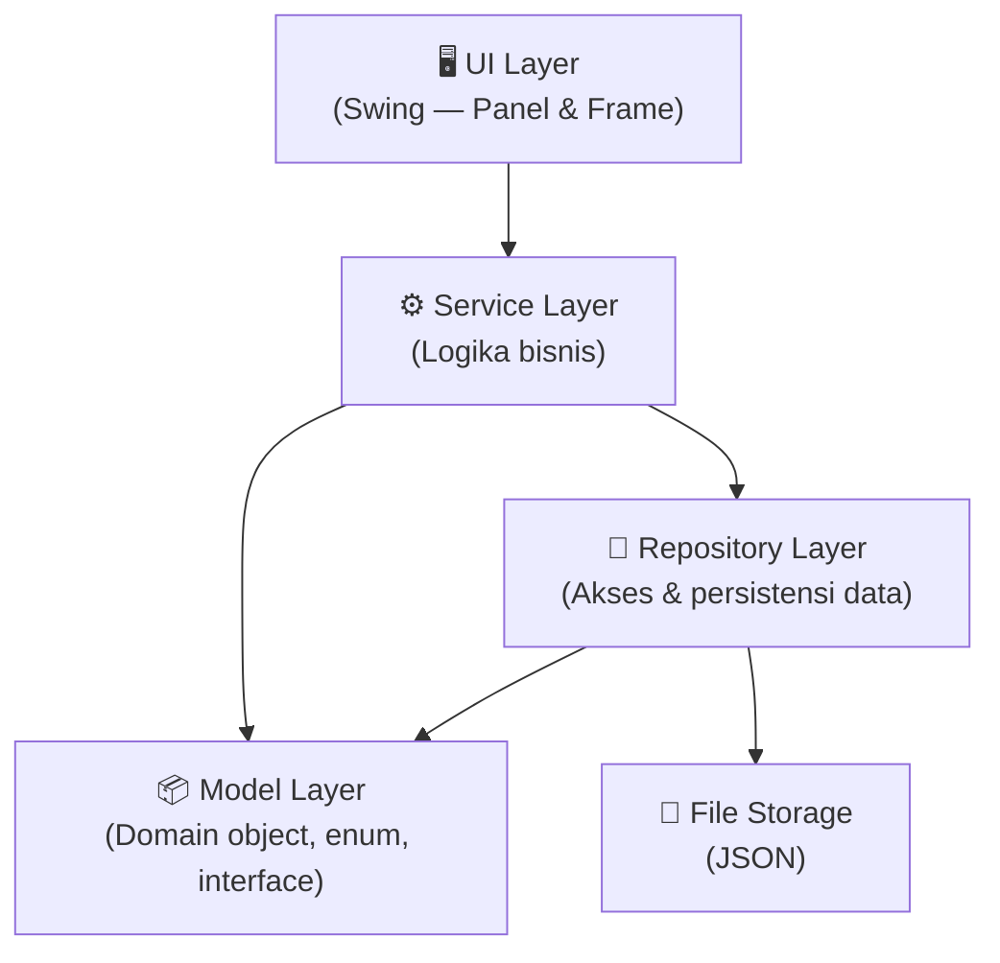

### Prinsip Utama

1. **Separation of Concerns** — Setiap lapisan punya tanggung jawab tunggal.
2. **Dependency ke bawah** — Lapisan atas bergantung pada lapisan bawah, tidak sebaliknya.
3. **Program to Interface** — Service dan repository diakses lewat interface/abstraksi.
4. **Testability** — Logika inti bisa diuji tanpa UI dan tanpa file.

---

## 2. Struktur Package

```
src/
└── com/sportfield/
    ├── Main.java                          # Entry point
    │
    ├── model/                             # Domain objects
    │   ├── user/
    │   │   ├── User.java                  # Abstract class
    │   │   ├── Customer.java              # Extends User
    │   │   └── Admin.java                 # Extends User
    │   │
    │   ├── field/
    │   │   ├── SportField.java            # Abstract class
    │   │   ├── BadmintonField.java         # Extends SportField
    │   │   ├── FutsalField.java           # Extends SportField
    │   │   ├── BasketballField.java        # Extends SportField
    │   │   └── TennisField.java           # Extends SportField
    │   │
    │   ├── booking/
    │   │   ├── Reservation.java           # Komposisi: field, slot, payment
    │   │   ├── TimeSlot.java              # equals/hashCode, Comparable
    │   │   └── Payment.java               # Data pembayaran
    │   │
    │   └── enums/
    │       ├── UserRole.java
    │       ├── FieldType.java
    │       ├── ReservationStatus.java      # Enum dengan behavior
    │       ├── PaymentStatus.java
    │       └── MemberLevel.java            # REGULER, VIP
    │
    ├── service/                            # Logika bisnis
    │   ├── AuthService.java
    │   ├── FieldService.java
    │   ├── ReservationService.java
    │   ├── PaymentService.java
    │   ├── ScheduleService.java
    │   └── ReportService.java
    │
    ├── repository/                         # Akses data
    │   ├── Repository.java                 # Interface generik: Repository<T>
    │   ├── AbstractJsonRepository.java     # Abstract class generik
    │   ├── UserRepository.java
    │   ├── FieldRepository.java
    │   ├── ReservationRepository.java
    │   └── PaymentRepository.java
    │
    ├── strategy/                           # Strategy pattern
    │   ├── payment/
    │   │   ├── PaymentMethod.java          # Interface
    │   │   ├── CashPayment.java
    │   │   ├── TransferPayment.java
    │   │   └── EWalletPayment.java         # (Could — F19)
    │   │
    │   ├── pricing/
    │   │   ├── PricingStrategy.java        # Interface
    │   │   ├── RegularPricing.java
    │   │   ├── PeakHourPricing.java
    │   │   └── WeekendPricing.java
    │   │
    │   └── discount/
    │       ├── Discountable.java           # Interface
    │       ├── RegularDiscount.java
    │       └── VipDiscount.java
    │
    ├── factory/                            # Factory pattern
    │   └── SportFieldFactory.java
    │
    ├── exception/                          # Custom exception
    │   ├── SportFieldBookingException.java # Base exception
    │   ├── SlotConflictException.java
    │   ├── PaymentException.java
    │   ├── AuthenticationException.java
    │   ├── InvalidInputException.java
    │   └── DataNotFoundException.java
    │
    ├── util/                               # Utilitas
    │   ├── PasswordHasher.java
    │   ├── IdGenerator.java
    │   ├── DateTimeHelper.java
    │   ├── JsonHelper.java
    │   └── AppConstants.java               # Static final constants
    │
    ├── session/                            # Singleton
    │   └── SessionManager.java
    │
    └── ui/                                 # Swing UI
        ├── MainFrame.java
        ├── components/                     # Komponen reusable
        │   ├── StyledButton.java
        │   ├── FormPanel.java
        │   └── TablePanel.java
        ├── auth/
        │   ├── LoginPanel.java
        │   └── RegisterPanel.java
        ├── customer/
        │   ├── CustomerDashboard.java
        │   ├── FieldListPanel.java
        │   ├── SlotSelectionPanel.java
        │   ├── ReservationFormPanel.java
        │   ├── PaymentPanel.java
        │   └── HistoryPanel.java
        └── admin/
            ├── AdminDashboard.java
            ├── ManageFieldPanel.java
            ├── ManageSchedulePanel.java
            └── ReportPanel.java
```

---

## 3. Class Diagram

### 3.1 Model — Hierarki User

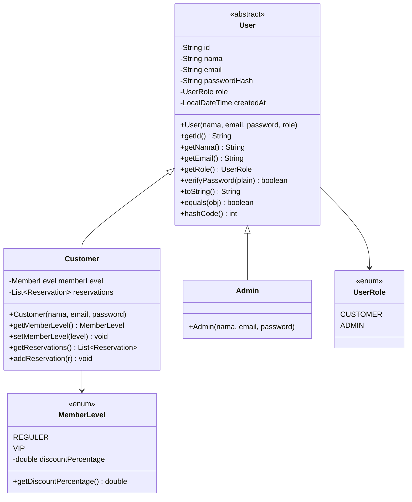

### 3.2 Model — Hierarki SportField

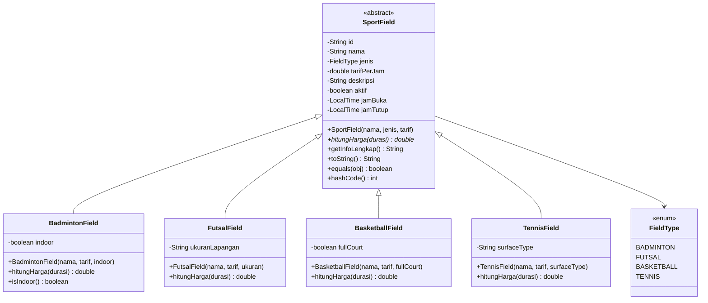

### 3.3 Model — Reservasi dan Pembayaran

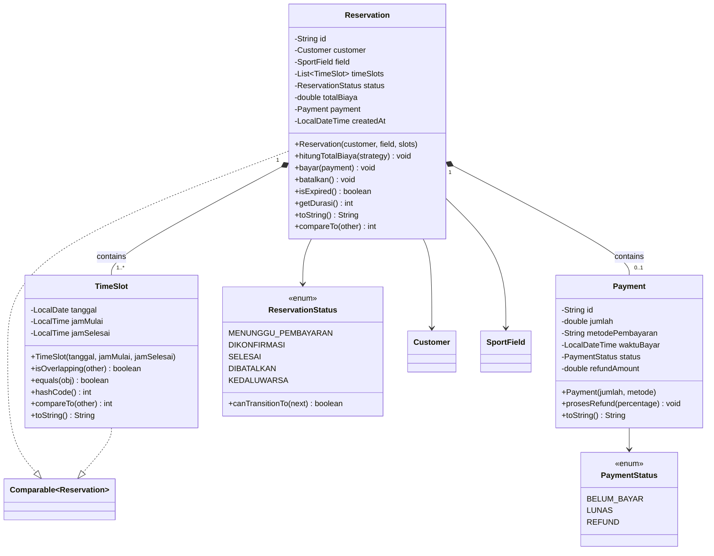

### 3.4 Strategy Pattern — Pembayaran, Pricing, Diskon

```mermaid
classDiagram
    class PaymentMethod {
        <<interface>>
        +processPayment(reservation, amount) Payment
        +getMethodName() String
    }

    class CashPayment {
        +processPayment(reservation, amount) Payment
        +getMethodName() String
    }

    class TransferPayment {
        -String bankName
        -String accountNumber
        +processPayment(reservation, amount) Payment
        +getMethodName() String
    }

    class EWalletPayment {
        -String walletProvider
        +processPayment(reservation, amount) Payment
        +getMethodName() String
    }

    PaymentMethod <|.. CashPayment
    PaymentMethod <|.. TransferPayment
    PaymentMethod <|.. EWalletPayment

    class PricingStrategy {
        <<interface>>
        +hitungHarga(field, timeSlots) double
    }

    class RegularPricing {
        +hitungHarga(field, timeSlots) double
    }

    class PeakHourPricing {
        -double multiplier
        +hitungHarga(field, timeSlots) double
    }

    class WeekendPricing {
        -double multiplier
        +hitungHarga(field, timeSlots) double
    }

    PricingStrategy <|.. RegularPricing
    PricingStrategy <|.. PeakHourPricing
    PricingStrategy <|.. WeekendPricing

    class Discountable {
        <<interface>>
        +getDiscountPercentage() double
        +applyDiscount(amount) double
    }

    class RegularDiscount {
        +getDiscountPercentage() double
        +applyDiscount(amount) double
    }

    class VipDiscount {
        +getDiscountPercentage() double
        +applyDiscount(amount) double
    }

    Discountable <|.. RegularDiscount
    Discountable <|.. VipDiscount
```

### 3.5 Repository Pattern (Generics)

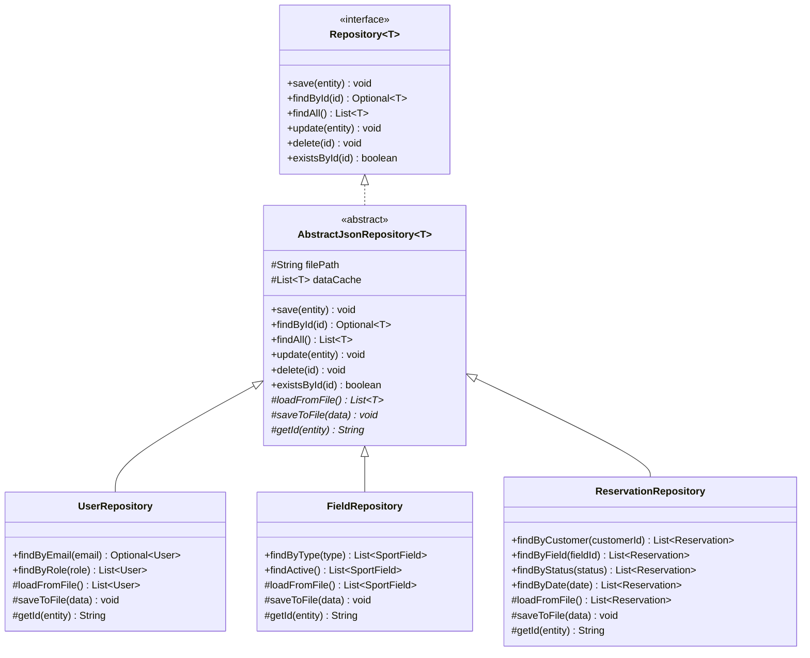

### 3.6 Factory Pattern

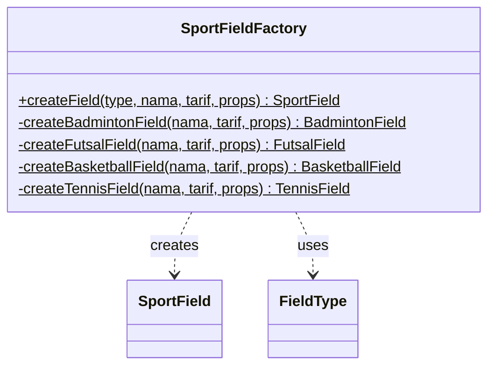

### 3.7 Singleton — SessionManager

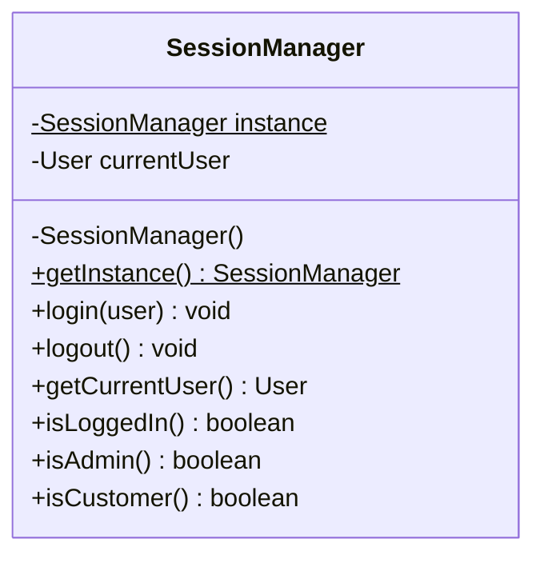

### 3.8 Service Layer

```mermaid
classDiagram
    class AuthService {
        -UserRepository userRepo
        -SessionManager session
        +register(nama, email, password) Customer
        +login(email, password) User
        +logout() void
        -validateRegistration(nama, email, password) void
    }

    class FieldService {
        -FieldRepository fieldRepo
        -SportFieldFactory factory
        +addField(type, nama, tarif, props) SportField
        +updateField(id, data) SportField
        +removeField(id) void
        +getAllFields() List~SportField~
        +getFieldsByType(type) List~SportField~
        +searchFields(keyword) List~SportField~
    }

    class ReservationService {
        -ReservationRepository reservationRepo
        -FieldRepository fieldRepo
        -PricingStrategy pricingStrategy
        +createReservation(customer, field, slots) Reservation
        +cancelReservation(id) void
        +getReservationsByCustomer(customerId) List~Reservation~
        +checkConflict(field, slots) boolean
        +checkExpiredReservations() void
        -validateSlots(field, slots) void
    }

    class PaymentService {
        -ReservationRepository reservationRepo
        +processPayment(reservationId, method) Payment
        +processRefund(reservationId) Payment
        -calculateRefundPercentage(reservation) double
    }

    class ReportService {
        -ReservationRepository reservationRepo
        +getReservationReport(startDate, endDate) List~Reservation~
        +getRevenueReport(startDate, endDate) double
        +getFieldUsageReport() Map~SportField, Integer~
        +sortReservations(list, comparator) List~Reservation~
    }

    AuthService --> UserRepository
    AuthService --> SessionManager
    FieldService --> FieldRepository
    FieldService --> SportFieldFactory
    ReservationService --> ReservationRepository
    ReservationService --> FieldRepository
    ReservationService --> PricingStrategy
    PaymentService --> ReservationRepository
    PaymentService --> PaymentMethod
    ReportService --> ReservationRepository
```

---

## 4. State Diagram — Status Reservasi

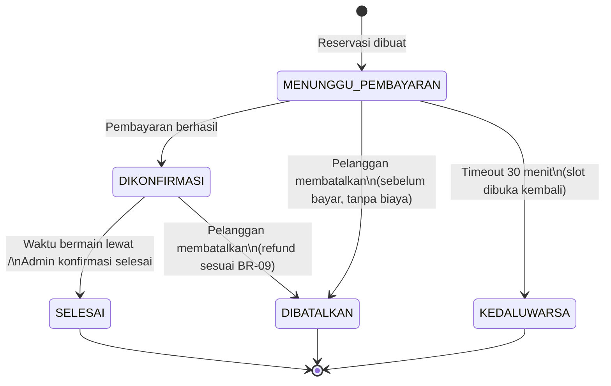

Transisi status divalidasi oleh method `ReservationStatus.canTransitionTo(ReservationStatus next)` — enum memiliki **behavior**, bukan hanya value.

---

## 5. Sequence Diagram — Alur Reservasi

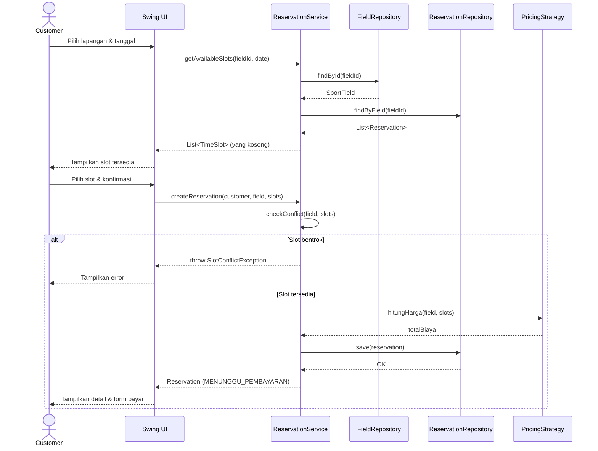

---

## 6. Sequence Diagram — Alur Pembayaran

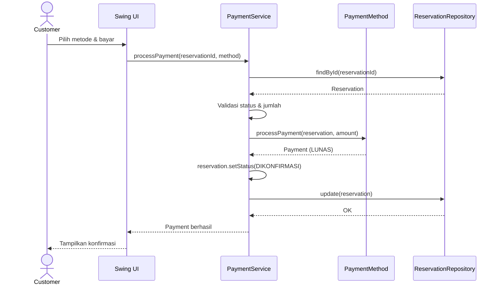

---

## 7. Design Pattern yang Digunakan

| Pattern | Lokasi | Tujuan | Fitur PRD |
|---|---|---|---|
| **Strategy** | `PaymentMethod`, `PricingStrategy`, `Discountable` | Mengubah algoritma pembayaran/pricing/diskon tanpa mengubah kode pemanggil | F07, F14, F15 |
| **Factory** | `SportFieldFactory` | Membuat objek `SportField` sesuai tipe tanpa expose logika pembuatan | F10 |
| **Singleton** | `SessionManager` | Satu instance session untuk seluruh aplikasi | F02 |
| **Repository** | `Repository<T>`, `AbstractJsonRepository<T>` | Abstraksi akses data dengan generics; mudah ganti storage | F12 |
| **State** (via enum) | `ReservationStatus.canTransitionTo()` | Validasi transisi status reservasi, enum punya behavior | F09, F17, F18 |
| **Observer** _(Could)_ | `NotificationService` | Notifikasi saat status reservasi berubah | F21 |

---

## 8. Pemetaan Konsep OOP → Kode

> Detail lengkap dengan lokasi baris kode akan dicatat di `OOP-CONCEPTS.md` setelah implementasi.

| # | Konsep OOP | Lokasi di Desain | Keterangan |
|---|---|---|---|
| 1 | **Class & Object** | Seluruh model, service, repository | Fondasi seluruh aplikasi |
| 2 | **Constructor** | Semua class — parameter constructor berbeda tiap subclass | Inisialisasi objek dengan validasi |
| 3 | **Encapsulation** | Semua field `private`, akses via getter/setter | Setter dengan validasi (mis. `setTarif` tolak nilai negatif) |
| 4 | **Inheritance** | `User` ← `Customer`, `Admin`; `SportField` ← `BadmintonField`, dll. | Hierarki bertingkat, reuse behavior |
| 5 | **Abstract Class** | `User`, `SportField`, `AbstractJsonRepository<T>` | Template method di repository; abstract `hitungHarga()` |
| 6 | **Interface** | `PaymentMethod`, `PricingStrategy`, `Discountable`, `Repository<T>` | Kontrak tanpa implementasi; multiple interface per class |
| 7 | **Polymorphism — Overriding** | `hitungHarga()` di setiap subclass `SportField`; `processPayment()` di setiap payment | Perilaku berbeda per tipe |
| 8 | **Polymorphism — Overloading** | `FieldService.searchFields(keyword)`, `searchFields(type)`, `searchFields(keyword, type)` | Method sama, parameter berbeda |
| 9 | **Composition** | `Reservation` memiliki `TimeSlot`, `Payment`, `SportField` | Objek menyusun objek lain, lifetime terikat |
| 10 | **Enum** | `ReservationStatus`, `FieldType`, `MemberLevel`, `PaymentStatus`, `UserRole` | Enum dengan field, constructor, dan method |
| 11 | **Static & Final** | `AppConstants` (final), `SportFieldFactory.createField()` (static), `SessionManager.getInstance()` (static) | Konstanta dan utility method |
| 12 | **Exception Handling** | Custom exceptions: `SlotConflictException`, `PaymentException`, dll. | try-catch di service, throw di validasi |
| 13 | **Collections & Generics** | `Repository<T>`, `List<Reservation>`, `Map<SportField, Integer>`, `Optional<T>` | Type-safe data structures |
| 14 | **`equals` / `hashCode`** | `TimeSlot` — menentukan apakah dua slot sama (untuk deteksi bentrok) | Kontrak equals-hashCode |
| 15 | **`Comparable` / `Comparator`** | `TimeSlot` implements `Comparable`; `Comparator<Reservation>` untuk sorting laporan | Sorting natural & custom |
| 16 | **`toString`** | Semua model class | Representasi string untuk debug & display |
| 17 | **Lambda & Stream** | `ReportService` — filter, map, sort, collect; pencarian slot tersedia | Java functional programming |
| 18 | **File I/O** | `AbstractJsonRepository` — baca/tulis JSON | Persistensi data |
| 19 | **Design Pattern** | Strategy, Factory, Singleton, Repository, State | Lihat tabel di bagian 7 |
| 20 | **Package & Access Modifier** | 6 package utama; `public`, `private`, `protected` digunakan tepat | Modularisasi & information hiding |

**Total: 20 konsep** (target PRD minimal 10).

---

## 9. Keputusan Teknis

### 9.1 Bahasa & Platform

| Keputusan | Pilihan | Alasan |
|---|---|---|
| Bahasa | Java 17+ | Sesuai ketentuan mata kuliah; fitur modern (records bisa dipertimbangkan) |
| UI | Swing | Sesuai materi kuliah |
| Build tool | Maven atau manual (`javac`) | Maven mempermudah dependency (Gson, JUnit); jika tidak boleh pakai Maven, compile manual |

### 9.2 Penyimpanan Data

| Keputusan | Pilihan | Alasan |
|---|---|---|
| Format file | **JSON** (via Gson) | Human-readable, mudah debug, struktur fleksibel |
| Lokasi file | `data/users.json`, `data/fields.json`, `data/reservations.json` | Terpisah per entitas, mudah dikelola |
| Strategi save | Tulis ulang seluruh file setiap kali ada perubahan | Sederhana, data tidak terlalu besar; cache di memory |

> **Alternatif**: Jika dosen tidak memperbolehkan library eksternal, gunakan **Java Serialization** (`ObjectInputStream`/`ObjectOutputStream`) atau **CSV** manual. Interface `Repository<T>` membuat penggantian storage mudah.

### 9.3 Password Hashing

Menggunakan `MessageDigest` SHA-256 bawaan Java (tanpa library eksternal). Password tidak pernah disimpan dalam bentuk plain text.

### 9.4 ID Generation

Menggunakan `UUID.randomUUID().toString()` untuk ID unik setiap entitas. Alternatif: auto-increment counter yang disimpan di file.

### 9.5 Penanganan Waktu

Menggunakan `java.time` API (`LocalDate`, `LocalTime`, `LocalDateTime`). Tidak menggunakan `java.util.Date` yang sudah legacy.

---

## 10. Struktur Data File (JSON)

### users.json
```json
[
  {
    "id": "u-001",
    "nama": "Admin Utama",
    "email": "admin@sportfield.com",
    "passwordHash": "5e884898da28047151...",
    "role": "ADMIN",
    "createdAt": "2026-10-27T08:00:00"
  },
  {
    "id": "u-002",
    "nama": "Budi Santoso",
    "email": "budi@email.com",
    "passwordHash": "a1b2c3d4e5f6...",
    "role": "CUSTOMER",
    "memberLevel": "REGULER",
    "createdAt": "2026-10-27T09:30:00"
  }
]
```

### fields.json
```json
[
  {
    "id": "f-001",
    "nama": "Lapangan Badminton A",
    "jenis": "BADMINTON",
    "tarifPerJam": 75000,
    "deskripsi": "Lapangan indoor, lantai vinyl",
    "aktif": true,
    "jamBuka": "08:00",
    "jamTutup": "22:00",
    "indoor": true
  }
]
```

### reservations.json
```json
[
  {
    "id": "r-001",
    "customerId": "u-002",
    "fieldId": "f-001",
    "timeSlots": [
      {
        "tanggal": "2026-11-01",
        "jamMulai": "10:00",
        "jamSelesai": "11:00"
      },
      {
        "tanggal": "2026-11-01",
        "jamMulai": "11:00",
        "jamSelesai": "12:00"
      }
    ],
    "status": "DIKONFIRMASI",
    "totalBiaya": 150000,
    "payment": {
      "id": "p-001",
      "jumlah": 150000,
      "metodePembayaran": "TRANSFER",
      "waktuBayar": "2026-10-28T10:05:00",
      "status": "LUNAS"
    },
    "createdAt": "2026-10-28T10:00:00"
  }
]
```

---

## 11. Seed Data (Data Bawaan)

Aplikasi memuat data awal saat pertama kali dijalankan (jika file belum ada):

| Data | Isi |
|---|---|
| Admin default | email: `admin@sportfield.com`, password: `admin123` |
| 4 lapangan contoh | 1 Badminton, 1 Futsal, 1 Basketball, 1 Tennis — masing-masing dengan tarif dan jam operasional |

---

## 12. Strategi Testing

| Jenis Test | Target | Tools |
|---|---|---|
| **Unit test** | Deteksi bentrok (`TimeSlot.isOverlapping`), hitung biaya, validasi status transition, aturan pembatalan/refund, factory | JUnit 5 |
| **Integration test** | Service + Repository (dengan file temporary) | JUnit 5 + temp files |
| **Manual test** | Alur end-to-end via UI | Skenario di `TEST-SCENARIOS.md` |

### Contoh Unit Test Kritis

```java
// Deteksi bentrok slot
@Test
void shouldDetectOverlappingSlots() {
    TimeSlot slot1 = new TimeSlot(LocalDate.of(2026, 11, 1),
                                   LocalTime.of(10, 0), LocalTime.of(11, 0));
    TimeSlot slot2 = new TimeSlot(LocalDate.of(2026, 11, 1),
                                   LocalTime.of(10, 30), LocalTime.of(11, 30));
    assertTrue(slot1.isOverlapping(slot2));
}

// Hitung biaya dengan tarif reguler
@Test
void shouldCalculateCorrectPrice() {
    PricingStrategy strategy = new RegularPricing();
    SportField field = new BadmintonField("Test", 75000, true);
    List<TimeSlot> slots = List.of(
        new TimeSlot(date, LocalTime.of(10, 0), LocalTime.of(11, 0)),
        new TimeSlot(date, LocalTime.of(11, 0), LocalTime.of(12, 0))
    );
    assertEquals(150000, strategy.hitungHarga(field, slots));
}

// Transisi status yang tidak valid harus gagal
@Test
void shouldRejectInvalidTransition() {
    assertFalse(ReservationStatus.SELESAI.canTransitionTo(ReservationStatus.MENUNGGU_PEMBAYARAN));
}
```

---

## 13. Konvensi Kode

| Aspek | Aturan |
|---|---|
| Penamaan class | `PascalCase` — `ReservationService`, `TimeSlot` |
| Penamaan method/variabel | `camelCase` — `hitungHarga()`, `totalBiaya` |
| Penamaan konstanta | `UPPER_SNAKE_CASE` — `MAX_DURASI_JAM` |
| Penamaan package | `lowercase` — `com.sportfield.model.user` |
| Bahasa kode | Campuran Indonesia (domain term) & Inggris (teknikal): `hitungHarga`, `getEmail`, `findById` |
| Komentar | Javadoc untuk public class dan method; inline comment seperlunya |
| Access modifier | Default `private`; `public` hanya untuk API yang dibutuhkan lapisan lain |

---

## 14. Pertanyaan Desain Terbuka

1. **Gson atau serialisasi Java?** — Gson lebih readable tapi butuh dependency. Jika dosen melarang library eksternal, fallback ke serialisasi Java atau CSV parser manual.
2. **JUnit diizinkan?** — Jika tidak, test bisa dilakukan di method `main` terpisah per class.
3. **Apakah perlu `ScheduleService` terpisah** atau cukup jam buka/tutup sebagai field di `SportField`?
4. **Observer pattern (F21)** — Implementasi dengan `PropertyChangeListener` bawaan Java atau custom interface?
5. **Apakah `TimeSlot` perlu immutable?** — Direkomendasikan ya, agar aman untuk deteksi bentrok dan sebagai key.
