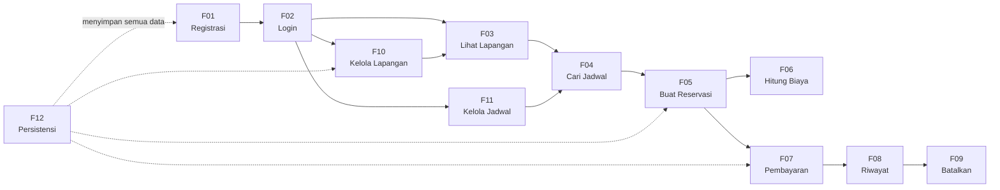

# FEATURES.md — Spesifikasi Fitur SportField Booking

| | |
|---|---|
| **Dokumen pendamping** | [PRD.md](./PRD.md), [DESIGN.md](./DESIGN.md) |
| **Versi** | 0.1 (draf awal) |
| **Tanggal** | 27 Oktober 2026 |
| **Cakupan** | Fitur Must (F01–F12) |

> Dokumen ini berisi spesifikasi detail setiap fitur: user story, aturan bisnis, validasi, perilaku sistem, edge case, dan acceptance criteria. Untuk daftar ringkas fitur lihat `PRD.md`; untuk desain teknis lihat `DESIGN.md`.

---

## F01 — Registrasi

### User Story

> **Sebagai** calon pelanggan,
> **saya ingin** membuat akun baru,
> **agar** saya bisa login dan memesan lapangan olahraga.

### Deskripsi

Pengguna baru mengisi form registrasi. Sistem memvalidasi data, menyimpan akun baru dengan role `CUSTOMER` dan level `REGULER`, lalu mengarahkan ke halaman login.

### Aturan

| ID | Aturan |
|---|---|
| F01-R01 | Semua field wajib diisi: **nama**, **email**, **password**, **konfirmasi password**. |
| F01-R02 | Email harus dalam format valid (mengandung `@` dan domain). |
| F01-R03 | Email harus **unik** — tidak boleh sama dengan akun yang sudah ada (BR-11). |
| F01-R04 | Password minimal **6 karakter** (BR-11). |
| F01-R05 | Password dan konfirmasi password harus **cocok**. |
| F01-R06 | Password disimpan dalam bentuk **hash** (SHA-256), bukan plain text (BR-11). |
| F01-R07 | Akun baru otomatis mendapat role `CUSTOMER` dan level `REGULER`. |
| F01-R08 | Nama minimal 2 karakter, hanya huruf dan spasi. |

### Input

| Field | Tipe | Wajib | Validasi |
|---|---|---|---|
| Nama | String | Ya | Min. 2 karakter, huruf dan spasi |
| Email | String | Ya | Format email valid, unik |
| Password | String | Ya | Min. 6 karakter |
| Konfirmasi Password | String | Ya | Harus sama dengan password |

### Perilaku Sistem

1. Tampilkan form registrasi dengan 4 field input.
2. Saat user klik "Daftar", validasi semua input sesuai aturan.
3. Jika ada error, tampilkan **pesan error spesifik** di samping field yang bermasalah. Form tidak dikosongkan.
4. Jika valid:
   a. Hash password.
   b. Buat objek `Customer` dengan ID unik (UUID).
   c. Simpan ke `UserRepository`.
   d. Tampilkan pesan sukses: _"Registrasi berhasil! Silakan login."_
   e. Arahkan ke halaman login.

### Edge Case & Error

| Kondisi | Respons Sistem |
|---|---|
| Email sudah terdaftar | `"Email sudah digunakan. Silakan gunakan email lain."` |
| Password < 6 karakter | `"Password minimal 6 karakter."` |
| Password ≠ konfirmasi | `"Password dan konfirmasi password tidak cocok."` |
| Nama kosong / < 2 char | `"Nama harus diisi (minimal 2 karakter)."` |
| Email format tidak valid | `"Format email tidak valid."` |

### Konsep OOP

- **Encapsulation**: field private, validasi di setter/constructor.
- **Custom Exception**: `InvalidInputException` untuk validasi gagal.
- **Inheritance**: `Customer` extends `User`.

### Acceptance Criteria

- [ ] Form registrasi menampilkan 4 field dan tombol "Daftar".
- [ ] Registrasi berhasil dengan data valid; data tersimpan di file.
- [ ] Login berhasil setelah registrasi.
- [ ] Email duplikat ditolak dengan pesan error yang jelas.
- [ ] Password < 6 karakter ditolak.
- [ ] Password ≠ konfirmasi ditolak.
- [ ] Password tersimpan dalam bentuk hash, bukan plain text.
- [ ] Semua field kosong menghasilkan pesan error masing-masing.

---

## F02 — Login & Logout

### User Story

> **Sebagai** pengguna (pelanggan atau admin),
> **saya ingin** masuk ke akun saya,
> **agar** saya bisa mengakses fitur sesuai peran saya.

> **Sebagai** pengguna yang sedang login,
> **saya ingin** keluar dari akun,
> **agar** akun saya aman jika komputer dipakai orang lain.

### Deskripsi

Pengguna memasukkan email dan password. Sistem memverifikasi kredensial, membuat session, dan menampilkan dashboard sesuai peran (pelanggan atau admin). Logout menghapus session dan kembali ke halaman login.

### Aturan

| ID | Aturan |
|---|---|
| F02-R01 | Login membutuhkan **email** dan **password**. |
| F02-R02 | Sistem mencocokkan password yang di-hash, bukan plain text. |
| F02-R03 | Jika kredensial valid, buat session via `SessionManager` (Singleton). |
| F02-R04 | Setelah login, arahkan ke dashboard sesuai **role**: `CustomerDashboard` atau `AdminDashboard`. |
| F02-R05 | Hanya satu user yang bisa login pada satu waktu (single-session). |
| F02-R06 | Logout menghapus session dan kembali ke halaman login. |
| F02-R07 | Fitur admin hanya bisa diakses oleh user dengan role `ADMIN`. |

### Input

| Field | Tipe | Wajib | Validasi |
|---|---|---|---|
| Email | String | Ya | Tidak kosong |
| Password | String | Ya | Tidak kosong |

### Perilaku Sistem

**Login:**
1. Tampilkan form login (email, password) dan tombol "Masuk". Ada link ke halaman registrasi.
2. Saat klik "Masuk", cari user berdasarkan email di `UserRepository`.
3. Jika ditemukan, hash password input lalu cocokkan dengan `passwordHash` yang tersimpan.
4. Jika cocok:
   a. Set user di `SessionManager.login(user)`.
   b. Redirect ke `CustomerDashboard` (jika `CUSTOMER`) atau `AdminDashboard` (jika `ADMIN`).
5. Jika tidak cocok, tampilkan error.

**Logout:**
1. Klik tombol "Logout" di dashboard.
2. `SessionManager.logout()` — clear current user.
3. Kembali ke halaman login.

### Edge Case & Error

| Kondisi | Respons Sistem |
|---|---|
| Email tidak ditemukan | `"Email atau password salah."` (pesan generik untuk keamanan) |
| Password salah | `"Email atau password salah."` |
| Field kosong | `"Email dan password wajib diisi."` |
| Sudah login, buka halaman login lagi | Redirect ke dashboard yang sesuai |

### Konsep OOP

- **Inheritance & Polymorphism**: `User` → `Customer` / `Admin`; dashboard dipilih berdasarkan tipe.
- **Singleton**: `SessionManager.getInstance()`.
- **Encapsulation**: password hashing internal.

### Acceptance Criteria

- [ ] Login berhasil dengan kredensial valid; masuk ke dashboard.
- [ ] Pelanggan melihat `CustomerDashboard`, admin melihat `AdminDashboard`.
- [ ] Kredensial salah menampilkan pesan error generik.
- [ ] Setelah logout, session kosong dan kembali ke login.
- [ ] Akses fitur admin oleh pelanggan dicegah.
- [ ] Admin default (seed) bisa login: `admin@sportfield.com` / `admin123`.

---

## F03 — Lihat Lapangan

### User Story

> **Sebagai** pelanggan,
> **saya ingin** melihat daftar lapangan yang tersedia,
> **agar** saya bisa memilih lapangan yang ingin dipesan.

### Deskripsi

Pelanggan melihat katalog semua lapangan yang aktif. Daftar bisa difilter berdasarkan jenis olahraga. Setiap lapangan menampilkan informasi lengkap termasuk tarif dan jam operasional.

### Aturan

| ID | Aturan |
|---|---|
| F03-R01 | Hanya lapangan dengan status `aktif = true` yang ditampilkan ke pelanggan. |
| F03-R02 | Daftar bisa difilter berdasarkan **jenis lapangan** (`FieldType`). |
| F03-R03 | Tanpa filter, semua lapangan aktif ditampilkan. |
| F03-R04 | Informasi yang ditampilkan: nama, jenis, tarif per jam, deskripsi, jam operasional, dan atribut khusus (misal: indoor/outdoor untuk badminton). |
| F03-R05 | Tarif ditampilkan dalam format mata uang Indonesia: `Rp 75.000/jam`. |

### Input

| Field | Tipe | Wajib | Validasi |
|---|---|---|---|
| Filter jenis | `FieldType` (dropdown) | Tidak | Pilihan: Semua, Badminton, Futsal, Basketball, Tennis |

### Perilaku Sistem

1. Saat masuk halaman, ambil semua lapangan aktif dari `FieldService.getAllFields()`.
2. Tampilkan dalam bentuk **tabel atau daftar kartu** dengan detail.
3. Jika user memilih filter jenis, panggil `FieldService.getFieldsByType(type)`.
4. Klik salah satu lapangan untuk melihat detail dan lanjut ke pencarian jadwal (F04).

### Edge Case & Error

| Kondisi | Respons Sistem |
|---|---|
| Belum ada lapangan sama sekali | Tampilkan pesan: `"Belum ada lapangan tersedia."` |
| Filter tidak ada hasil | `"Tidak ada lapangan jenis [X] yang tersedia."` |
| Semua lapangan nonaktif | Sama seperti tidak ada lapangan |

### Konsep OOP

- **Abstract class & Polymorphism**: `SportField` (abstract) → subclass menampilkan `getInfoLengkap()` berbeda per jenis.
- **Enum**: `FieldType` untuk filter.
- **Collections & Stream**: filter/sort daftar lapangan.

### Acceptance Criteria

- [ ] Daftar lapangan aktif tampil saat halaman dibuka.
- [ ] Filter per jenis olahraga berfungsi.
- [ ] Detail lengkap tampil (nama, jenis, tarif, deskripsi, jam operasional).
- [ ] Lapangan nonaktif **tidak** muncul di daftar pelanggan.
- [ ] Tarif ditampilkan dalam format rupiah.
- [ ] Pesan informatif jika tidak ada lapangan.

---

## F04 — Cari Jadwal (Slot Kosong)

### User Story

> **Sebagai** pelanggan,
> **saya ingin** melihat slot waktu yang masih kosong pada tanggal tertentu,
> **agar** saya tahu kapan bisa bermain dan bisa langsung memesan.

### Deskripsi

Pelanggan memilih lapangan dan tanggal, lalu sistem menampilkan semua slot 1 jam dalam jam operasional, menandai mana yang kosong dan mana yang sudah dipesan.

### Aturan

| ID | Aturan |
|---|---|
| F04-R01 | Tanggal yang bisa dipilih: **hari ini sampai 14 hari ke depan** (BR-04). |
| F04-R02 | Slot dibagi per **1 jam** sesuai jam operasional lapangan (misal 08:00–09:00, 09:00–10:00, ..., 21:00–22:00). |
| F04-R03 | Slot dianggap **terisi** jika ada reservasi aktif (`MENUNGGU_PEMBAYARAN` atau `DIKONFIRMASI`) yang overlap. |
| F04-R04 | Slot di masa lalu (hari ini tapi jam sudah lewat) ditandai **tidak tersedia**. |
| F04-R05 | Pencarian bisa dilakukan lewat 2 cara (method overloading): <br> a. `cariSlot(fieldId, tanggal)` — slot di satu lapangan. <br> b. `cariSlot(fieldType, tanggal)` — slot di semua lapangan sejenis. |

### Input

| Field | Tipe | Wajib | Validasi |
|---|---|---|---|
| Lapangan | `SportField` (dropdown/pilih) | Ya* | Lapangan harus aktif |
| Jenis Lapangan | `FieldType` (dropdown) | Ya* | Alternatif dari pilih lapangan spesifik |
| Tanggal | `LocalDate` (date picker) | Ya | Hari ini s.d. +14 hari |

_*Salah satu wajib dipilih (lapangan spesifik atau jenis)._

### Perilaku Sistem

1. Pelanggan memilih lapangan (atau jenis) dan tanggal.
2. Sistem membangun daftar semua slot berdasarkan jam operasional lapangan.
3. Sistem mengambil reservasi aktif pada lapangan dan tanggal tersebut dari `ReservationRepository`.
4. Tandai setiap slot: ✅ **Kosong** atau ❌ **Terisi**.
5. Jika tanggal = hari ini, slot yang jamnya sudah lewat ditandai ⛔ **Lewat**.
6. Tampilkan dalam tabel/grid. Slot kosong bisa diklik untuk lanjut ke reservasi (F05).

### Contoh Tampilan

```
Lapangan Badminton A — Sabtu, 1 November 2026

| Slot          | Status   |
|---------------|----------|
| 08:00 – 09:00 | ✅ Kosong |
| 09:00 – 10:00 | ✅ Kosong |
| 10:00 – 11:00 | ❌ Terisi |
| 11:00 – 12:00 | ❌ Terisi |
| 12:00 – 13:00 | ✅ Kosong |
| ...           | ...      |
| 21:00 – 22:00 | ✅ Kosong |
```

### Edge Case & Error

| Kondisi | Respons Sistem |
|---|---|
| Tanggal di masa lalu | `"Tanggal harus hari ini atau setelahnya."` |
| Tanggal > 14 hari | `"Maksimal pemesanan 14 hari ke depan."` |
| Semua slot terisi | Semua ditandai ❌; pesan: `"Tidak ada slot kosong pada tanggal ini."` |
| Lapangan tidak aktif | Tidak muncul di dropdown |

### Konsep OOP

- **Method Overloading**: `cariSlot(fieldId, tanggal)` vs `cariSlot(fieldType, tanggal)`.
- **Collections & Stream**: filter slot berdasarkan reservasi aktif.
- **`equals`/`hashCode`** pada `TimeSlot`: menentukan kesamaan slot.

### Acceptance Criteria

- [ ] Slot kosong dan terisi ditampilkan dengan jelas untuk tanggal yang dipilih.
- [ ] Hanya tanggal hari ini s.d. +14 hari yang bisa dipilih.
- [ ] Slot yang sudah lewat (hari ini, jam lalu) ditandai tidak tersedia.
- [ ] Slot yang sudah dipesan (status aktif) ditandai terisi.
- [ ] Pencarian bisa per lapangan spesifik maupun per jenis.
- [ ] Slot kosong bisa dipilih untuk lanjut ke reservasi.

---

## F05 — Buat Reservasi

### User Story

> **Sebagai** pelanggan,
> **saya ingin** memesan lapangan pada slot waktu tertentu,
> **agar** saya bisa bermain olahraga pada waktu yang saya pilih.

### Deskripsi

Pelanggan memilih lapangan, tanggal, jam mulai, dan durasi. Sistem mengecek bentrok, menghitung biaya, dan membuat reservasi baru dengan status `MENUNGGU_PEMBAYARAN`.

### Aturan

| ID | Aturan |
|---|---|
| F05-R01 | Satu slot hanya boleh memiliki **satu reservasi aktif** (BR-02). Reservasi aktif = status `MENUNGGU_PEMBAYARAN` atau `DIKONFIRMASI`. |
| F05-R02 | Durasi reservasi: **1 sampai 3 jam berurutan** pada lapangan yang sama (BR-03). |
| F05-R03 | Semua slot yang dipesan harus **dalam jam operasional** lapangan. |
| F05-R04 | Reservasi hanya untuk **waktu mendatang**, maksimal 14 hari ke depan (BR-04). |
| F05-R05 | Jika jam mulai + durasi melewati jam tutup, reservasi **ditolak**. |
| F05-R06 | Status awal reservasi: `MENUNGGU_PEMBAYARAN`. |
| F05-R07 | Biaya otomatis dihitung saat reservasi dibuat (lihat F06). |
| F05-R08 | Waktu pembuatan (`createdAt`) dicatat untuk keperluan batas waktu pembayaran (F17). |

### Input

| Field | Tipe | Wajib | Validasi |
|---|---|---|---|
| Lapangan | `SportField` | Ya | Harus aktif |
| Tanggal | `LocalDate` | Ya | Hari ini s.d. +14 hari |
| Jam Mulai | `LocalTime` | Ya | Dalam jam operasional, harus di masa depan |
| Durasi | Integer (jam) | Ya | 1, 2, atau 3 |

### Perilaku Sistem

1. Pelanggan mengisi form atau memilih dari grid slot kosong (dari F04).
2. Sistem membangun `List<TimeSlot>` berdasarkan jam mulai dan durasi:
   - Durasi 2 jam, mulai 10:00 → `[10:00–11:00, 11:00–12:00]`
3. Validasi:
   a. Semua slot dalam jam operasional?
   b. Tidak melewati jam tutup?
   c. Tanggal valid (tidak di masa lalu, tidak > 14 hari)?
   d. Jika hari ini, jam mulai belum lewat?
4. Cek bentrok: `ReservationService.checkConflict(field, slots)`.
   - Ambil semua reservasi aktif pada lapangan dan tanggal tersebut.
   - Cek `TimeSlot.isOverlapping()` antara slot baru dan slot yang sudah dipesan.
5. Jika bentrok → throw `SlotConflictException`.
6. Jika valid:
   a. Hitung biaya via `PricingStrategy.hitungHarga(field, slots)`.
   b. Buat objek `Reservation`.
   c. Simpan ke `ReservationRepository`.
   d. Tampilkan **halaman konfirmasi** dengan detail reservasi dan total biaya.
   e. Tawarkan langsung ke pembayaran (F07).

### Edge Case & Error

| Kondisi | Respons Sistem |
|---|---|
| Slot bentrok | `SlotConflictException`: `"Slot [jam] pada tanggal [tanggal] sudah dipesan."` |
| Durasi melewati jam tutup | `"Durasi melebihi jam operasional. Jam tutup lapangan ini: [jam]."` |
| Tanggal di masa lalu | `"Tidak bisa memesan untuk tanggal yang sudah lewat."` |
| Jam mulai sudah lewat (hari ini) | `"Jam mulai sudah lewat. Pilih jam yang lain."` |
| Durasi bukan 1–3 | `"Durasi harus antara 1 sampai 3 jam."` |
| Dua pelanggan memesan slot sama hampir bersamaan | Deteksi saat save: cek ulang sebelum simpan (optimistic check) |

### Konsep OOP

- **Composition**: `Reservation` memiliki `Customer`, `SportField`, `List<TimeSlot>`, `Payment`.
- **Custom Exception**: `SlotConflictException`.
- **`equals`/`hashCode`**: `TimeSlot` — dua slot sama jika tanggal, jam mulai, dan jam selesai sama.

### Acceptance Criteria

- [ ] Reservasi berhasil dibuat dengan status `MENUNGGU_PEMBAYARAN`.
- [ ] Total biaya terhitung otomatis dan ditampilkan.
- [ ] Slot yang bentrok **ditolak** dengan pesan jelas.
- [ ] Durasi 1, 2, dan 3 jam berfungsi.
- [ ] Durasi yang melewati jam tutup ditolak.
- [ ] Tanggal di masa lalu dan > 14 hari ditolak.
- [ ] Data reservasi tersimpan di file dan muncul di riwayat (F08).
- [ ] Slot yang baru dipesan langsung tampil sebagai "terisi" di pencarian (F04).
- [ ] **Tidak mungkin** terjadi dua reservasi aktif pada slot yang sama (bentrok).

---

## F06 — Hitung Biaya

### User Story

> **Sebagai** sistem,
> **saya harus** menghitung total biaya secara otomatis,
> **agar** pelanggan tahu jumlah yang harus dibayar sebelum mengonfirmasi reservasi.

### Deskripsi

Biaya dihitung berdasarkan tarif lapangan, durasi, dan (jika aktif) strategi pricing dan diskon. Fitur ini bukan layar tersendiri — kalkulasi terjadi saat reservasi dibuat (F05) dan ditampilkan sebelum pelanggan mengonfirmasi.

### Aturan

| ID | Aturan |
|---|---|
| F06-R01 | Rumus dasar: **tarif per jam × durasi (jumlah slot)** (BR-05). |
| F06-R02 | Setiap subclass `SportField` meng-override `hitungHarga(durasi)` — polymorphism. |
| F06-R03 | Jika fitur tarif dinamis (F14, Should) aktif: harga bisa berbeda per slot tergantung `PricingStrategy`. |
| F06-R04 | Jika fitur diskon (F15, Should) aktif: diskon diterapkan setelah total dihitung. |
| F06-R05 | Total biaya **tidak boleh negatif**. Minimum Rp 0. |
| F06-R06 | Total ditampilkan dalam format rupiah: `Rp 150.000`. |

### Contoh Perhitungan

```
Lapangan Badminton A — tarif Rp 75.000/jam
Durasi: 2 jam (10:00–12:00)

Perhitungan dasar (RegularPricing):
  = Rp 75.000 × 2
  = Rp 150.000

Dengan tarif dinamis (PeakHourPricing, multiplier 1.5×):
  = Rp 75.000 × 1.5 × 2
  = Rp 225.000

Dengan diskon VIP (10%):
  = Rp 225.000 × 0.9
  = Rp 202.500
```

### Konsep OOP

- **Overriding**: `hitungHarga()` berbeda per subclass `SportField`.
- **Abstraction**: `PricingStrategy` (interface) — caller tidak tahu implementasi mana yang aktif.
- **Strategy Pattern**: `RegularPricing`, `PeakHourPricing`, `WeekendPricing`.

### Acceptance Criteria

- [ ] Biaya dihitung otomatis saat reservasi dibuat.
- [ ] Rumus dasar benar: tarif × durasi.
- [ ] Setiap jenis lapangan bisa punya logika harga sendiri (`hitungHarga` override).
- [ ] Total ditampilkan sebelum pelanggan mengonfirmasi reservasi.
- [ ] Total tidak pernah negatif.
- [ ] Format tampilan rupiah benar.

---

## F07 — Pembayaran

### User Story

> **Sebagai** pelanggan,
> **saya ingin** membayar reservasi saya,
> **agar** reservasi dikonfirmasi dan slot terjamin untuk saya.

### Deskripsi

Setelah reservasi dibuat (status `MENUNGGU_PEMBAYARAN`), pelanggan memilih metode pembayaran dan melakukan pembayaran. Sistem mencatat pembayaran dan mengubah status menjadi `DIKONFIRMASI`. Pembayaran bersifat **simulasi** — tidak ada transaksi keuangan nyata.

### Aturan

| ID | Aturan |
|---|---|
| F07-R01 | Minimal **2 metode pembayaran**: Tunai (`CashPayment`) dan Transfer Bank (`TransferPayment`). |
| F07-R02 | Pembayaran harus **lunas dalam satu transaksi** (BR-07). |
| F07-R03 | Nominal pembayaran harus **sama persis** dengan total biaya (BR-07). |
| F07-R04 | Hanya reservasi dengan status `MENUNGGU_PEMBAYARAN` yang bisa dibayar. |
| F07-R05 | Setelah bayar sukses: status reservasi → `DIKONFIRMASI`, `PaymentStatus` → `LUNAS`. |
| F07-R06 | Waktu pembayaran dicatat (`waktuBayar`). |
| F07-R07 | Metode pembayaran dipilih lewat **Strategy pattern** — menambah metode baru tidak mengubah kode pemanggil. |

### Input

| Field | Tipe | Wajib | Validasi |
|---|---|---|---|
| Reservasi | `Reservation` (dari daftar) | Ya | Status harus `MENUNGGU_PEMBAYARAN` |
| Metode Pembayaran | Pilihan (Tunai / Transfer) | Ya | Harus memilih salah satu |
| Nominal | Double | Ya | Harus sama dengan total biaya |

**Input tambahan per metode:**

| Metode | Field Tambahan |
|---|---|
| Tunai | _(tidak ada)_ |
| Transfer Bank | Nama bank, nomor rekening (simulasi) |

### Perilaku Sistem

1. Pelanggan memilih reservasi yang belum dibayar (dari halaman konfirmasi F05 atau riwayat F08).
2. Sistem menampilkan detail reservasi dan total biaya.
3. Pelanggan memilih metode pembayaran dan mengisi nominal.
4. Validasi:
   a. Status reservasi = `MENUNGGU_PEMBAYARAN`?
   b. Nominal = total biaya?
   c. Reservasi belum expired? (jika F17 aktif)
5. Jika valid:
   a. Buat objek `Payment` via `PaymentMethod.processPayment()`.
   b. Set `reservation.status` → `DIKONFIRMASI`.
   c. Update di `ReservationRepository`.
   d. Tampilkan **bukti pembayaran**: ID transaksi, jumlah, metode, waktu.
6. Jika tidak valid, tampilkan error.

### Edge Case & Error

| Kondisi | Respons Sistem |
|---|---|
| Nominal ≠ total biaya | `"Nominal pembayaran harus Rp [total]. Pembayaran sebagian tidak diperbolehkan."` |
| Reservasi sudah dibayar | `"Reservasi ini sudah dibayar."` |
| Reservasi expired | `"Reservasi ini sudah kedaluwarsa. Silakan buat reservasi baru."` |
| Reservasi dibatalkan | `"Reservasi ini sudah dibatalkan."` |
| Status bukan MENUNGGU_PEMBAYARAN | `"Reservasi tidak dapat dibayar (status: [status])."` |

### Konsep OOP

- **Interface & Strategy**: `PaymentMethod` → `CashPayment`, `TransferPayment`.
- **Polymorphism**: `processPayment()` perilaku berbeda per metode.
- **Open/Closed**: tambah `EWalletPayment` (F19) tanpa ubah kode yang sudah ada.

### Acceptance Criteria

- [ ] Minimal 2 metode pembayaran tersedia (Tunai, Transfer).
- [ ] Pembayaran berhasil mengubah status → `DIKONFIRMASI`.
- [ ] Nominal yang tidak sesuai ditolak.
- [ ] Reservasi yang bukan `MENUNGGU_PEMBAYARAN` tidak bisa dibayar.
- [ ] Bukti pembayaran ditampilkan setelah sukses.
- [ ] Data payment tersimpan di file.
- [ ] Menambah metode baru tidak memerlukan perubahan di `PaymentService` (Open/Closed).

---

## F08 — Cek Status & Riwayat Reservasi

### User Story

> **Sebagai** pelanggan,
> **saya ingin** melihat daftar reservasi saya beserta statusnya,
> **agar** saya bisa memantau reservasi yang aktif, selesai, atau dibatalkan.

### Deskripsi

Pelanggan melihat daftar semua reservasinya (aktif, selesai, dibatalkan, kedaluwarsa). Daftar bisa diurutkan dan menampilkan detail status.

### Aturan

| ID | Aturan |
|---|---|
| F08-R01 | Hanya menampilkan reservasi milik **pelanggan yang sedang login**. |
| F08-R02 | Setiap reservasi menampilkan: lapangan, tanggal, jam, durasi, total biaya, status reservasi, status pembayaran. |
| F08-R03 | Daftar bisa **diurutkan** berdasarkan tanggal (terbaru/terlama) atau status. |
| F08-R04 | Warna/ikon berbeda per status agar mudah dibedakan. |
| F08-R05 | Dari riwayat, pelanggan bisa melakukan aksi: **Bayar** (jika `MENUNGGU_PEMBAYARAN`) atau **Batalkan** (jika bisa dibatalkan). |

### Perilaku Sistem

1. Saat masuk halaman, ambil `ReservationService.getReservationsByCustomer(customerId)`.
2. Tampilkan dalam **tabel** dengan kolom: No, Lapangan, Tanggal, Jam, Durasi, Total, Status, Aksi.
3. Default: urutkan berdasarkan tanggal terbaru (`Comparator<Reservation>`).
4. Pelanggan bisa pilih pengurutan lain (dropdown).
5. Tombol aksi muncul kontekstual:
   - `MENUNGGU_PEMBAYARAN`: tombol **[Bayar]** dan **[Batalkan]**.
   - `DIKONFIRMASI`: tombol **[Batalkan]**.
   - `SELESAI`, `DIBATALKAN`, `KEDALUWARSA`: _(tidak ada aksi)_.

### Edge Case & Error

| Kondisi | Respons Sistem |
|---|---|
| Belum punya reservasi | `"Anda belum memiliki reservasi."` dengan tombol ke halaman lapangan. |
| Semua reservasi sudah selesai/batal | Ditampilkan normal, tanpa tombol aksi. |

### Konsep OOP

- **Enum**: `ReservationStatus` menentukan tampilan dan aksi.
- **`Comparable`/`Comparator`**: sorting reservasi berdasarkan tanggal, status.
- **Stream**: filter dan sort daftar reservasi.

### Acceptance Criteria

- [ ] Daftar reservasi pelanggan yang login tampil.
- [ ] Setiap reservasi menampilkan detail lengkap.
- [ ] Pengurutan berdasarkan tanggal dan status berfungsi.
- [ ] Tombol aksi kontekstual muncul sesuai status.
- [ ] Reservasi milik pelanggan lain **tidak** terlihat.
- [ ] Pesan informatif jika belum ada reservasi.

---

## F09 — Batalkan Reservasi

### User Story

> **Sebagai** pelanggan,
> **saya ingin** membatalkan reservasi saya,
> **agar** saya tidak dikenakan biaya untuk jadwal yang tidak bisa saya penuhi, dan slot bisa dipakai orang lain.

### Deskripsi

Pelanggan membatalkan reservasi yang statusnya `MENUNGGU_PEMBAYARAN` atau `DIKONFIRMASI`. Slot yang dibatalkan dibuka kembali. Jika sudah dibayar, refund dihitung berdasarkan selisih waktu dengan jadwal bermain.

### Aturan

| ID | Aturan |
|---|---|
| F09-R01 | Reservasi `MENUNGGU_PEMBAYARAN` bisa dibatalkan **tanpa biaya** (BR-09). |
| F09-R02 | Reservasi `DIKONFIRMASI` bisa dibatalkan dengan **kebijakan refund** (BR-09): |
| | — ≥ 24 jam sebelum jadwal bermain → refund **100%** |
| | — 2–24 jam sebelum → refund **50%** |
| | — < 2 jam sebelum → refund **0%** |
| F09-R03 | Status berubah menjadi `DIBATALKAN`. |
| F09-R04 | Slot yang terkait **dibuka kembali** (muncul sebagai kosong di F04). |
| F09-R05 | Reservasi `SELESAI`, `DIBATALKAN`, dan `KEDALUWARSA` **tidak bisa** dibatalkan. |
| F09-R06 | Pelanggan hanya bisa membatalkan reservasi **miliknya sendiri**. |

### Input

| Field | Tipe | Wajib | Validasi |
|---|---|---|---|
| Reservasi | `Reservation` (dari riwayat) | Ya | Status `MENUNGGU_PEMBAYARAN` atau `DIKONFIRMASI`, milik pelanggan |

### Perilaku Sistem

1. Pelanggan klik **[Batalkan]** pada reservasi di halaman riwayat (F08).
2. Sistem menampilkan **konfirmasi pembatalan**:
   - Jika belum bayar: _"Reservasi akan dibatalkan tanpa biaya."_
   - Jika sudah bayar: _"Refund [X]% (Rp [jumlah]) akan dicatat."_
3. Pelanggan konfirmasi "Ya, batalkan".
4. Sistem:
   a. Validasi status dan kepemilikan.
   b. Hitung refund jika sudah bayar.
   c. Set `reservation.status` → `DIBATALKAN`.
   d. Jika ada refund: set `payment.status` → `REFUND`, catat `refundAmount`.
   e. Update di `ReservationRepository`.
   f. Slot kini tersedia kembali (karena cek bentrok hanya melihat reservasi aktif).
5. Tampilkan pesan sukses.

### Contoh Skenario Refund

```
Jadwal bermain: 1 Nov 2026, 10:00
Waktu pembatalan: 31 Okt 2026, 08:00
Selisih: 26 jam → ≥ 24 jam → refund 100%

Jadwal bermain: 1 Nov 2026, 10:00
Waktu pembatalan: 1 Nov 2026, 01:00
Selisih: 9 jam → 2–24 jam → refund 50%

Jadwal bermain: 1 Nov 2026, 10:00
Waktu pembatalan: 1 Nov 2026, 09:00
Selisih: 1 jam → < 2 jam → refund 0%
```

### Edge Case & Error

| Kondisi | Respons Sistem |
|---|---|
| Status `SELESAI` | `"Reservasi yang sudah selesai tidak dapat dibatalkan."` |
| Status `DIBATALKAN` | `"Reservasi ini sudah dibatalkan sebelumnya."` |
| Status `KEDALUWARSA` | `"Reservasi ini sudah kedaluwarsa."` |
| Bukan milik pelanggan | Tombol batalkan tidak muncul (dicegah di UI) |
| Jadwal sudah lewat, status masih DIKONFIRMASI | Seharusnya sudah jadi SELESAI (F18); jika belum, tetap bisa batal dengan refund 0% |

### Konsep OOP

- **State** (via Enum): `ReservationStatus.canTransitionTo(DIBATALKAN)` — validasi transisi.
- **Custom Exception**: `InvalidStateTransitionException` jika transisi tidak valid.
- **Enum dengan behavior**: menentukan aturan refund berdasarkan status dan waktu.

### Acceptance Criteria

- [ ] Reservasi `MENUNGGU_PEMBAYARAN` bisa dibatalkan tanpa biaya.
- [ ] Reservasi `DIKONFIRMASI` bisa dibatalkan dengan refund sesuai aturan.
- [ ] Refund 100% jika ≥ 24 jam, 50% jika 2–24 jam, 0% jika < 2 jam.
- [ ] Status berubah menjadi `DIBATALKAN`.
- [ ] Slot yang dibatalkan muncul kembali sebagai kosong di pencarian jadwal.
- [ ] Reservasi `SELESAI` / `DIBATALKAN` / `KEDALUWARSA` tidak bisa dibatalkan.
- [ ] Dialog konfirmasi muncul sebelum pembatalan.
- [ ] Refund amount tercatat di data payment.

---

## F10 — Kelola Lapangan (Admin)

### User Story

> **Sebagai** admin,
> **saya ingin** menambah, mengubah, dan menghapus lapangan,
> **agar** daftar lapangan selalu up-to-date sesuai ketersediaan fasilitas.

### Deskripsi

Admin melakukan CRUD (Create, Read, Update, Delete) pada data lapangan. Pembuatan lapangan menggunakan **Factory pattern** berdasarkan jenis. Penghapusan dicegah jika masih ada reservasi aktif.

### Aturan

| ID | Aturan |
|---|---|
| F10-R01 | Hanya user dengan role `ADMIN` yang bisa mengakses fitur ini. |
| F10-R02 | **Tambah**: admin memilih jenis lapangan, lalu mengisi data. `SportFieldFactory` membuat objek yang sesuai. |
| F10-R03 | **Ubah**: admin bisa mengubah nama, tarif, deskripsi, jam operasional, dan atribut khusus. Jenis lapangan **tidak bisa diubah**. |
| F10-R04 | **Hapus**: lapangan yang masih punya reservasi aktif (`MENUNGGU_PEMBAYARAN` atau `DIKONFIRMASI`) **tidak boleh dihapus** (BR-10). |
| F10-R05 | Sebagai alternatif hapus, admin bisa **menonaktifkan** lapangan (`aktif = false`). Lapangan nonaktif tidak tampil di pelanggan tapi data tetap ada. |
| F10-R06 | Tarif per jam harus **> 0**. |
| F10-R07 | Jam buka harus **lebih awal** dari jam tutup. |
| F10-R08 | Nama lapangan tidak boleh kosong. |

### Input — Tambah Lapangan

| Field | Tipe | Wajib | Validasi |
|---|---|---|---|
| Jenis | `FieldType` (dropdown) | Ya | Pilih salah satu |
| Nama | String | Ya | Tidak kosong |
| Tarif per Jam | Double | Ya | > 0 |
| Deskripsi | String | Tidak | — |
| Jam Buka | `LocalTime` | Ya | < Jam Tutup |
| Jam Tutup | `LocalTime` | Ya | > Jam Buka |
| Atribut khusus | Tergantung jenis | Tidak | Lihat tabel di bawah |

**Atribut khusus per jenis:**

| Jenis | Atribut | Tipe |
|---|---|---|
| Badminton | Indoor/Outdoor | Boolean |
| Futsal | Ukuran lapangan | String (misal: "25x15m") |
| Basketball | Full court / Half court | Boolean |
| Tennis | Jenis permukaan | String (misal: "Hard court") |

### Perilaku Sistem

**Tambah:**
1. Admin pilih jenis lapangan dari dropdown.
2. Form atribut khusus muncul sesuai jenis (polymorphism di UI).
3. Admin isi data dan klik "Simpan".
4. `SportFieldFactory.createField(type, nama, tarif, props)` membuat objek.
5. Simpan ke `FieldRepository`.

**Ubah:**
1. Admin pilih lapangan dari daftar, klik "Ubah".
2. Form terisi data yang ada (pre-filled).
3. Admin edit dan klik "Simpan".
4. Update di `FieldRepository`.

**Hapus:**
1. Admin pilih lapangan, klik "Hapus".
2. Sistem cek reservasi aktif.
3. Jika ada → tolak, tawarkan nonaktifkan.
4. Jika tidak ada → konfirmasi, lalu hapus.

### Edge Case & Error

| Kondisi | Respons Sistem |
|---|---|
| Hapus dengan reservasi aktif | `"Lapangan tidak bisa dihapus karena masih memiliki [N] reservasi aktif. Nonaktifkan saja?"` |
| Tarif ≤ 0 | `"Tarif per jam harus lebih dari Rp 0."` |
| Jam buka ≥ jam tutup | `"Jam buka harus lebih awal dari jam tutup."` |
| Nama kosong | `"Nama lapangan wajib diisi."` |

### Konsep OOP

- **Factory Pattern**: `SportFieldFactory.createField()` — pembuatan objek berdasarkan tipe.
- **Inheritance**: `SportField` → subclass per jenis.
- **Encapsulation**: setter dengan validasi (tarif > 0, jam buka < jam tutup).

### Acceptance Criteria

- [ ] Admin bisa menambah lapangan baru dengan memilih jenis.
- [ ] Factory membuat objek subclass yang benar sesuai jenis.
- [ ] Admin bisa mengubah data lapangan (kecuali jenis).
- [ ] Admin bisa menghapus lapangan tanpa reservasi aktif.
- [ ] Lapangan dengan reservasi aktif **tidak bisa dihapus** (error dengan pesan jelas).
- [ ] Admin bisa menonaktifkan lapangan sebagai alternatif.
- [ ] Validasi tarif, jam, dan nama berfungsi.
- [ ] Data tersimpan ke file.
- [ ] Hanya admin yang bisa akses.

---

## F11 — Kelola Jadwal Operasional (Admin)

### User Story

> **Sebagai** admin,
> **saya ingin** mengatur jam operasional setiap lapangan,
> **agar** slot yang tersedia untuk pelanggan sesuai dengan jam buka lapangan sebenarnya.

### Deskripsi

Admin mengatur jam buka dan jam tutup per lapangan. Jadwal ini menentukan slot apa saja yang ditampilkan di pencarian (F04). Bisa juga digunakan untuk menutup lapangan di hari tertentu (misalnya maintenance).

### Aturan

| ID | Aturan |
|---|---|
| F11-R01 | Jam operasional default: **08:00–22:00** (BR-01). |
| F11-R02 | Admin bisa mengubah jam buka dan jam tutup **per lapangan**. |
| F11-R03 | Jam buka harus lebih awal dari jam tutup. |
| F11-R04 | Slot dibagi per **1 jam** (BR-01). |
| F11-R05 | Perubahan jadwal **tidak mempengaruhi** reservasi yang sudah ada. |
| F11-R06 | Jika admin mempersempit jam (misal 10:00–20:00), slot di luar jam baru yang **belum** dipesan tidak akan ditampilkan lagi. Reservasi yang sudah ada di jam lama tetap berlaku. |

### Input

| Field | Tipe | Wajib | Validasi |
|---|---|---|---|
| Lapangan | `SportField` (dropdown/pilih) | Ya | — |
| Jam Buka | `LocalTime` | Ya | Format HH:mm, < Jam Tutup |
| Jam Tutup | `LocalTime` | Ya | Format HH:mm, > Jam Buka |

### Perilaku Sistem

1. Admin memilih lapangan dari daftar.
2. Sistem menampilkan jam buka dan tutup saat ini.
3. Admin mengubah jam dan klik "Simpan".
4. Validasi jam buka < jam tutup.
5. Update `SportField.jamBuka` dan `SportField.jamTutup`.
6. Simpan ke `FieldRepository`.
7. Pencarian slot (F04) otomatis menyesuaikan.

### Edge Case & Error

| Kondisi | Respons Sistem |
|---|---|
| Jam buka ≥ jam tutup | `"Jam buka harus lebih awal dari jam tutup."` |
| Ada reservasi di slot yang mau dihapus | Perubahan tetap disimpan; reservasi lama tidak terpengaruh, tapi slot baru di luar jam operasional tidak bisa dipesan lagi. |

### Konsep OOP

- **Collections**: list slot digenerate dari jam buka/tutup.
- **Encapsulation**: validasi di setter `setJamBuka()`, `setJamTutup()`.

### Acceptance Criteria

- [ ] Jam operasional default 08:00–22:00 untuk lapangan baru.
- [ ] Admin bisa mengubah jam buka dan tutup per lapangan.
- [ ] Validasi jam buka < jam tutup berfungsi.
- [ ] Perubahan jadwal langsung mempengaruhi slot yang ditampilkan di F04.
- [ ] Reservasi yang sudah ada tidak terpengaruh oleh perubahan jadwal.
- [ ] Data tersimpan ke file.

---

## F12 — Persistensi Data

### User Story

> **Sebagai** pengguna,
> **saya ingin** data saya tetap ada setelah aplikasi ditutup,
> **agar** saya tidak perlu mengulang registrasi atau memasukkan data kembali.

### Deskripsi

Semua data (user, lapangan, reservasi, pembayaran) disimpan secara permanen di file JSON. Data dimuat saat aplikasi dibuka dan disimpan setiap kali ada perubahan.

### Aturan

| ID | Aturan |
|---|---|
| F12-R01 | Data disimpan di folder `data/` dalam format **JSON**. |
| F12-R02 | File terpisah per entitas: `users.json`, `fields.json`, `reservations.json`. |
| F12-R03 | Data dimuat ke memory (cache) saat aplikasi **startup**. |
| F12-R04 | Setiap operasi tulis (create, update, delete) langsung **persist ke file**. |
| F12-R05 | Jika file belum ada saat startup, buat file baru dan isi **seed data** (admin default + lapangan contoh). |
| F12-R06 | Repository menggunakan **generics**: `Repository<T>` dan `AbstractJsonRepository<T>`. |
| F12-R07 | Jika file rusak/corrupt, tampilkan error dan buat backup dari file rusak, lalu inisialisasi ulang. |

### Struktur File

```
project-root/
├── data/
│   ├── users.json
│   ├── fields.json
│   └── reservations.json
├── src/
│   └── ...
```

### Perilaku Sistem

**Startup:**
1. Cek apakah folder `data/` ada. Jika tidak, buat.
2. Untuk setiap file JSON:
   a. Jika ada → load ke memory cache (`List<T>`).
   b. Jika tidak ada → buat file baru, isi seed data, load ke cache.
   c. Jika corrupt → backup file lama (`users.json.bak`), buat baru, isi seed.
3. Aplikasi siap digunakan dengan data di memory.

**Operasi tulis:**
1. Ubah data di memory cache.
2. Tulis ulang seluruh file JSON (overwrite).

**Shutdown:**
1. Pastikan semua perubahan sudah tersimpan (seharusnya sudah, karena save setiap operasi).

### Seed Data

| File | Data Bawaan |
|---|---|
| `users.json` | 1 admin: `Admin Utama`, `admin@sportfield.com`, password `admin123` (hashed) |
| `fields.json` | 4 lapangan contoh (1 Badminton, 1 Futsal, 1 Basketball, 1 Tennis) dengan tarif dan jam operasional berbeda |
| `reservations.json` | Kosong (`[]`) |

### Edge Case & Error

| Kondisi | Respons Sistem |
|---|---|
| File tidak ada | Buat baru + seed data |
| File corrupt (JSON invalid) | Backup file → buat baru + seed data. Log warning. |
| Folder `data/` tidak ada | Buat folder otomatis |
| Error saat menulis file | Tampilkan error; data di memory tetap ada untuk session ini |
| File terkunci oleh proses lain | Retry, lalu tampilkan error |

### Konsep OOP

- **Repository Pattern**: `Repository<T>` interface — abstraksi akses data.
- **Generics**: `Repository<T>`, `AbstractJsonRepository<T>` — type-safe untuk semua entitas.
- **Abstract Class**: `AbstractJsonRepository<T>` — template method (`loadFromFile`, `saveToFile`, `getId`).
- **File I/O**: baca/tulis JSON via Gson.
- **Encapsulation**: detail penyimpanan tersembunyi di balik interface `Repository`.

### Acceptance Criteria

- [ ] Semua data tersimpan di file JSON di folder `data/`.
- [ ] Data tetap ada setelah aplikasi ditutup dan dibuka kembali.
- [ ] Seed data (admin + 4 lapangan) otomatis dibuat jika file belum ada.
- [ ] Admin default bisa login setelah pertama kali menjalankan aplikasi.
- [ ] File corrupt ditangani gracefully (backup + inisialisasi ulang).
- [ ] Repository menggunakan generics (`Repository<T>`).
- [ ] Semua operasi CRUD di service layer otomatis ter-persist.

---

## Ringkasan Keterkaitan Antar-Fitur



### Alur Utama Pelanggan

```
F01 (Registrasi) → F02 (Login) → F03 (Lihat Lapangan) → F04 (Cari Jadwal)
→ F05 (Buat Reservasi) + F06 (Hitung Biaya) → F07 (Pembayaran)
→ F08 (Riwayat) → F09 (Batalkan, jika perlu)
```

### Alur Utama Admin

```
F02 (Login) → F10 (Kelola Lapangan) / F11 (Kelola Jadwal)
```

---

## Lampiran: Checklist Konsep OOP per Fitur

| Konsep | F01 | F02 | F03 | F04 | F05 | F06 | F07 | F08 | F09 | F10 | F11 | F12 |
|---|---|---|---|---|---|---|---|---|---|---|---|---|
| Encapsulation | ✅ | ✅ | | | | | | | | ✅ | ✅ | |
| Inheritance | ✅ | ✅ | ✅ | | | | | | | ✅ | | |
| Abstract class | | | ✅ | | | | | | | | | ✅ |
| Interface | | | | | | ✅ | ✅ | | | | | ✅ |
| Polymorphism (override) | | ✅ | ✅ | | | ✅ | ✅ | | | | | |
| Polymorphism (overload) | | | | ✅ | | | | | | | | |
| Composition | | | | | ✅ | | | | | | | |
| Enum | | | ✅ | | | | | ✅ | ✅ | | | |
| Custom Exception | ✅ | | | | ✅ | | ✅ | | ✅ | | | |
| Collections | | | ✅ | ✅ | ✅ | | | ✅ | | | ✅ | |
| Generics | | | | | | | | | | | | ✅ |
| equals/hashCode | | | | ✅ | ✅ | | | | | | | |
| Comparable/Comparator | | | | | | | | ✅ | | | | |
| Stream & Lambda | | | ✅ | ✅ | | | | ✅ | | | | |
| Strategy | | | | | | ✅ | ✅ | | | | | |
| Factory | | | | | | | | | | ✅ | | |
| Singleton | | ✅ | | | | | | | | | | |
| File I/O | | | | | | | | | | | | ✅ |
| toString | ✅ | | ✅ | | ✅ | | | ✅ | | | | |
| Static/Final | | | | | | | | | | | | ✅ |
